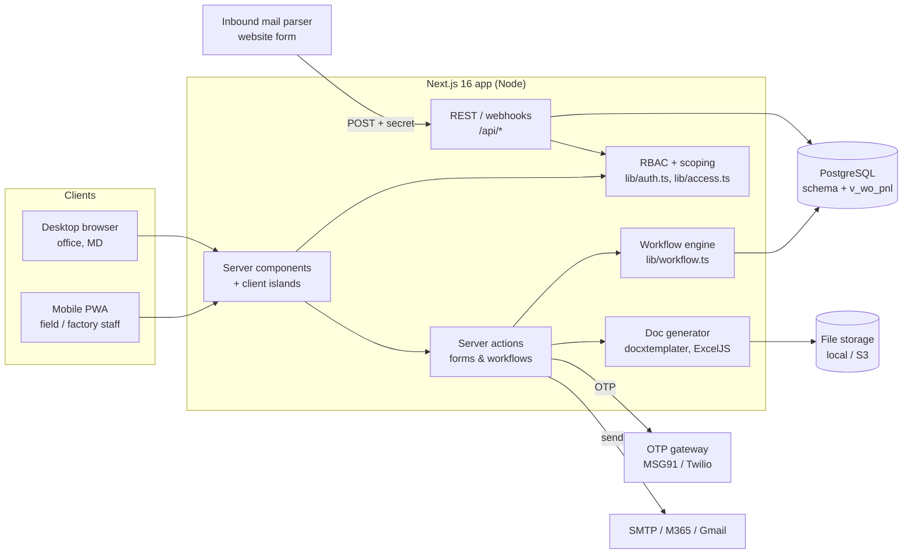

# Architecture

## Key decisions

| Area | Decision | Why |
|---|---|---|
| App | Next.js App Router, TypeScript, Tailwind 4, Recharts | Single deployable; server components keep sensitive data and SQL on the server |
| Data access | Plain SQL via `pg` with a thin helper (`lib/db.ts`); SQL migrations in `db/migrations` | Transparent queries for reporting-heavy screens; no ORM engine binaries to ship |
| Auth | Mobile + 6-digit OTP (HMAC-hashed, 5-min expiry, 5 attempts, 5 requests / 15 min per mobile or IP). Optional 4-digit PIN only on devices previously verified by OTP. Sessions are DB rows referenced by a signed JWT cookie, so they can be listed and revoked remotely; optional single-device lock | Field staff on shared/low-end phones |
| Authorisation | `permission(role, module, action, scope)`; `scopeSql()` turns the scope into a SQL predicate (own → team (recursive reportees) → vertical → company). Record loaders (`loadLead`, `loadWo`, `loadProposal`) 404 on out-of-scope records; file downloads re-check the parent record | One rule set for pages, actions, exports and files |
| Workflow | `lib/workflow.ts` holds the lead→proposal→approval→won→WO→PR→PO logic as transactional functions with no request context | Same code from UI, APIs, seed and tests |
| Costing | `lib/costing.ts` is a pure function shared by the browser (live totals) and server (authoritative save) | What the user sees is what is saved |
| Profitability | Single `cost_entry` ledger with a DB constraint for one cost centre; `v_wo_pnl` view | Every rupee lands on a WO or an admin centre |
| Documents | Templates are ordinary .docx/.xlsx files with `{{merge.fields}}`, versioned in `template`, test-rendered on upload | Business users edit layouts in Word/Excel |
| Audit | `audit()` on every mutation, login, export, download, approval | Compliance |
| PWA | Manifest + service worker caching static assets; installable | Works like an app on phones |

## Performance notes
Reporting reads `v_wo_pnl` and indexed aggregates. When volume grows (5 years, 500+ users), convert `v_wo_pnl` and the monthly trend into materialized views refreshed by a scheduled job (pg_cron / pg-boss) — the queries in `lib/queries.ts` don't change.

## Not yet implemented (honest list)
- **Background job queue** (BullMQ/pg-boss) for SLA escalation, reminders, daily digest and scheduled MIS emails. Tasks have `escalation_level`, and overdue items surface on dashboards, but no automatic escalation job runs yet.
- **Offline capture** for attendance/DPR (service worker caches the shell only).
- **Postgres row-level security policies**: scoping is enforced in the application layer for every query. Add RLS as defence-in-depth when moving to Supabase.
- **S3 driver**: `lib/storage.ts` exposes `putFile/getFile`; only the local-disk driver is implemented.
- **Server-side PDF**: PDF is produced via the print view (browser "Save as PDF"). For server-side PDF, add LibreOffice/Gotenberg to convert the generated .docx.
- **Selfie on check-in**: the column exists, but the UI does not capture a selfie yet.
