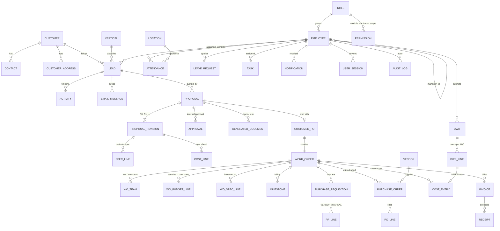

# Data model (ERD)

Source of truth: `db/migrations/001_core.sql` (+ `002_reporting_views.sql`). PostgreSQL, UUID keys, money as `numeric(16,2)` INR.

**Key rule:** every `cost_entry` has exactly one cost centre — a Work Order (`cost_centre='WO'` + `wo_id`), `OFFICE_ADMIN` or `FACTORY_ADMIN`. Enforced by the DB check constraint `cost_entry_one_centre`. All WO P&Ls and dashboards aggregate from this ledger (`v_wo_pnl`).

## Phase 1 — CRM, proposals, orders, people

## Table groups

| Group | Tables |
|---|---|
| Organisation & masters | `company`, `location` (HO/Factory/Site, geofence, shift), `vertical`, `department`, `designation`, `item`, `vendor`, `template`, `number_series`, `app_setting` |
| Access & security | `role`, `permission`, `employee` (user = employee; mobile = login), `otp_request`, `user_session`, `audit_log`, `approval_rule`, `approval` |
| CRM | `customer`, `customer_address`, `contact`, `lead`, `activity`, `email_message`, `attachment` |
| Proposals | `proposal`, `proposal_revision` (params/terms/totals JSON), `spec_line`, `cost_line`, `generated_document` |
| Orders | `customer_po`, `work_order`, `wo_team`, `wo_budget_line`, `wo_spec_line`, `milestone` |
| Purchase (Phase 1 slice) | `purchase_requisition`, `pr_line`, `purchase_order`, `po_line` |
| Cost & finance | `cost_entry` (the ledger), `budget` (admin heads), `invoice`, `receipt` |
| People & time | `task`, `dwr`, `dwr_line`, `attendance`, `attendance_lock`, `holiday`, `leave_type`, `leave_request`, `notification` |
| Reporting | view `v_wo_pnl` — contract, billed, received, budget, actual, committed, EAC, est. margin, cost & schedule RAG |

## Phase 2/3 entities (planned, not yet in schema)

`RFQ, VendorQuote, GRN, VendorBill, Payment, Inventory, StockTransaction, JobOrder, JobStage, JobCard, Drawing, DrawingRevision, InspectionRequest, InspectionReport, NCR, Dispatch, DispatchDocument, ICReport, Certificate, OMContract, Asset, PMSchedule, ServiceCall, ConsultancyPO, Deliverable, Shift, Payroll, ExpenseClaim (today: cost_entry with source EXPENSE_CLAIM), Contractor/ContractLabour, BG/EMD`. Each attaches to `work_order` and posts its costs to `cost_entry`, so the P&L spine does not change.
